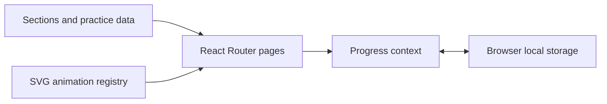

# System Design Academy

**Learn system design by watching the mechanics, practicing the decisions, and tracking your progress.**

A React learning app with an animated concept library, interview practice, design exercises, and cheat sheets. The curriculum is organized into 13 sections covering networking, storage, reliability, security, and complete system designs.

[Get started](#get-started) · [Learning experience](#learning-experience) · [Architecture](#architecture) · [Extend the course](#extend-the-course)

## Why this exists

Static diagrams show what a system contains but often hide how requests move through it. This project connects explanations with SVG animations and practice surfaces so students and interview candidates can study a concept, inspect its mechanics, and return to it later.

## Learning experience

- Animated lessons for concepts such as load balancing, caching, sharding, queues, and consensus.
- A dashboard, concept library, interview page, design studio, and cheat-sheet page.
- Supporting quiz, flashcard, learning-path, and design-drill data.
- Progress and preferences persisted in the current browser through local storage.
- A shared visual theme and reusable SVG primitives.

## Get started

Download the repository using GitHub's **Code → Download ZIP**, extract it, and open a terminal in its root. Use Node.js with npm.

```bash
npm install
npm run dev
```

Open the URL printed by Vite, normally `http://localhost:5173`.

```bash
npm run build
npm run preview
```

The build writes `dist/`; preview serves that build locally. There is no backend setup or API-key requirement in the current app.

## Example learning session

1. Open the concept library at `/learn`.
2. Choose a topic and inspect its animation and explanatory content.
3. Visit `/interview` for practice or `/design` for a design exercise.
4. Return to the dashboard to review the progress saved in this browser.

## Architecture



`App.jsx` composes the navigation and routes. Content files supply the lessons; the animation registry maps lesson animation keys to React components. The progress context handles persistent learner state.

## Project structure

| Path | Responsibility |
| --- | --- |
| [src/App.jsx](src/App.jsx) | Application shell and routes |
| [src/sections](src/sections) | Curriculum content, one file per section |
| [src/animations](src/animations) | SVG animations and registry |
| [src/pages](src/pages) | Dashboard, library, interviews, design studio, and cheat sheets |
| [src/data](src/data) | Curriculum assembly and practice material |
| [src/context/ProgressContext.jsx](src/context/ProgressContext.jsx) | Progress and preferences |
| [src/theme.js](src/theme.js) | Colors and font stacks |

## Extend the course

- Add a lesson to the relevant file in `src/sections/` and use a registered animation key.
- Add animations in `src/animations/`, then register them in `src/animations/index.js`.
- Import new sections into `src/data/curriculum.js`.
- Keep explanations, practice data, and animations consistent when changing a concept.

## Current scope

This is a browser-based learning app. Local progress is specific to the browser and is not an account-backed synchronization service. If deploying the Vite output, configure the host to serve the app entry point for client-side routes.

The project uses React, React Router, and Vite. The earlier single-file course has been organized into reusable modules.
